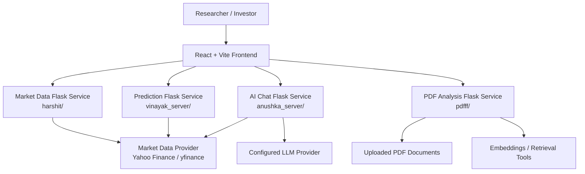
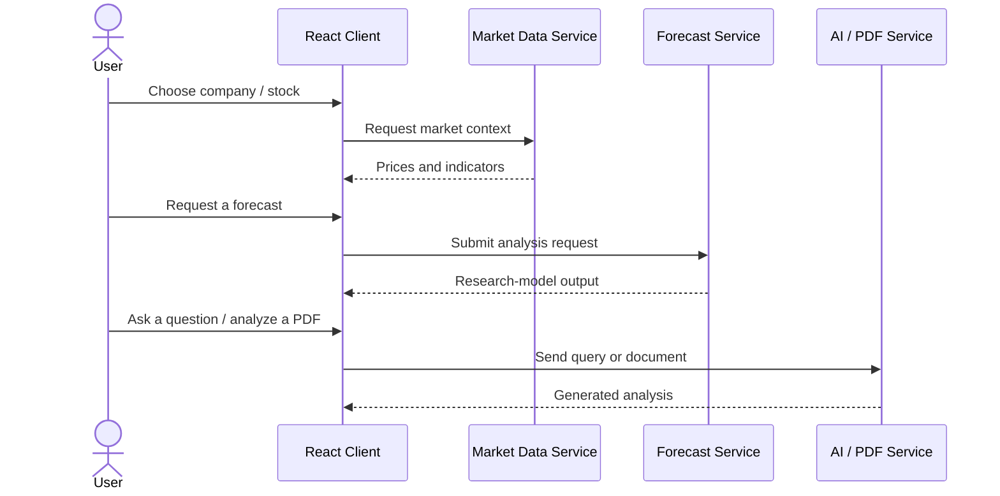

<div align="center">

# 📈 InitIQ
### AI-Powered Stock Intelligence & Investment Research Platform

**Market insights · Machine-learning forecasts · Financial AI chat · Document analysis**

[](https://react.dev/)
[](https://vite.dev/)
[](https://www.python.org/)
[](https://flask.palletsprojects.com/)
[](#prediction-and-analytics)
[](#about-the-project)

*An integrated research workspace for exploring market behavior, comparing forecasts, and asking questions about financial information.*

</div>
## 📚 Contents

- [About the project](#about-the-project)
- [Why InitIQ?](#why-initiq)
- [Main capabilities](#main-capabilities)
- [Architecture](#architecture)
- [Technology stack](#technology-stack)
- [Repository structure](#repository-structure)
- [Getting started](#getting-started)
- [API overview](#api-overview)
- [Prediction and analytics](#prediction-and-analytics)
- [Screenshots](#screenshots)
- [Troubleshooting](#troubleshooting)
- [Security and limitations](#security-and-limitations)
- [Future improvements](#future-improvements)
- [Contributing](#contributing)

## About the project

**InitIQ** (originally documented as **Init.io**) is a full-stack stock-analysis and investment-research platform developed as a hackathon project. Its goal is to bring data exploration, technical indicators, machine-learning forecasts, conversational AI, and financial-report question answering into one interface.

The repository is organized as a **React/Vite client** with several **Flask-based service directories**, allowing market data, predictions, AI chat, and PDF processing to be developed separately.

## Why InitIQ?

Investment research usually means switching between price charts, market news, forecasts, and long reports. InitIQ explores how an integrated user experience can make these complementary research workflows more accessible:

1. **Explore** current and historical market information.
2. **Analyze** trends, technical indicators, and model-produced forecasts.
3. **Ask** natural-language questions using an AI assistant.
4. **Read** uploaded financial documents with a retrieval-assisted workflow.
5. **Compare** evidence rather than relying on a single forecast.

## Main capabilities

| Area | Functionality described in the repository |
| --- | --- |
| Market dashboard | Market visualization, stock movers, company details, responsive UI |
| Stock discovery | Screening and filtering investment candidates |
| Technical analysis | Charting and indicators such as RSI, MACD, and Bollinger Bands |
| Prediction engine | Multi-model research experiments and stock-forecast endpoints |
| News intelligence | Financial-news analysis and sentiment-related workflows |
| AI assistant | Natural-language stock questions and conversational analysis |
| Financial document analysis | PDF upload, parsing, retrieval, and question answering |
| Portfolio research | Risk-aware portfolio/stock recommendation concepts |

> The table captures **documented project scope**. Features may vary by service configuration and API-key availability; do not interpret them as a verified production feature list.

## Architecture

The following diagram shows the **documented logical separation**.



### Example user journeys


## Technology stack

| Layer | Technologies documented by the project |
| --- | --- |
| Web UI | React 19, Vite, Tailwind CSS, React Router, Axios |
| Visualization | Recharts, GSAP, Three.js |
| Web APIs | Python, Flask, Flask-CORS |
| Data processing | Pandas, NumPy, yfinance |
| ML / forecasting | Scikit-learn, TensorFlow, XGBoost; other time-series methods described in the project |
| LLM workflows | LangChain, Groq, Google Generative AI |
| Document retrieval | PyPDF2, FAISS and embedding integrations |
| Developer workflows | Bash and PowerShell service-launch scripts |

## Repository structure

```text
Synergy-Hackathon_DJ/
├── client/                 # React / Vite frontend
├── server-2/         # Stock forecasting and analysis service
├── server-1/         # AI chat and analysis service
├── market_data_retrieval/                # Market data service
├── pdfff/                  # PDF analysis service
├── extension-component/
│   └── extention/          # Additional extension directory
├── start_servers.sh        # Unix / macOS backend launcher
├── start_servers.ps1       # Windows backend launcher
├── README_servers.md       # Backend launch-script documentation
└── README.md               # Project documentation
```

## Getting started

### Prerequisites

- Git
- Node.js and npm (Node.js **18+** is recommended by the original README; confirm actual package engine requirements)
- Python **3.9+** and `pip`
- API credentials required by the services you intend to run

### 1. Clone the repository

```bash
git clone https://github.com/purav-12345/InitIQ-AI-Stock-Intelligence-Platform.git
cd InitIQ-AI-Stock-Intelligence-Platform
```

### 2. Start the frontend

```bash
cd client
npm install
npm run dev
```

### 3. Start the backend services

Open another terminal in the **repository root**. The existing `README_servers.md` documents automatic scripts that look for `app.py` or `main.py`, create virtual environments, install service dependencies where available, and assign available ports.

**macOS / Linux / WSL**

```bash
chmod +x start_servers.sh
./start_servers.sh
```

**Windows PowerShell**

```powershell
.\start_servers.ps1
```

### 4. Manual backend setup (alternative)

The repository's existing instructions describe separate Flask entrypoints. For a service containing `requirements.txt`, a typical procedure is:

```bash
cd server-2
python -m venv myenv
# Linux / macOS:
source myenv/bin/activate
# Windows PowerShell instead:
# .\myenv\Scripts\Activate.ps1
pip install -r requirements.txt
python app.py
```

### 5. Configure API credentials

For services using Groq, Google AI, financial data, or other external providers, determine the exact environment variable names expected in their source files and set them **locally**. Do not commit `.env`, tokens, or private keys. An example workflow is:

```bash
# Create a local .env file in a service directory only if that service loads it.
# Add the keys documented by that service's application code.
```

There is no verified universal `.env` schema in the publicly inspected documentation.

## API overview

The original project README documents the following example endpoints. **Confirm the precise server, method, request body, and response schema in code before depending on them.**

| Area | Method | Route | Intended use |
| --- | --- | --- | --- |
| Stock data | GET | `/api/stock_data` | Price / stock data |
| Forecasts | GET | `/api/forecast` | Forecast information |
| Model predictions | POST | `/api/predictions` | Generate ML estimates |
| Technical analysis | GET | `/api/technical_analysis` | Technical indicators |
| Market data | GET | `/api/stock-market-data` | Market overview |
| News | GET | `/api/news` | Market-related news |
| Recommendations | GET | `/api/recommendation` | Research suggestions |
| AI analysis | POST | `/analyze` | Conversational analysis |
| AI queries | POST | `/query` | Natural-language queries |
| PDF processing | POST | `/upload` | Upload a document |
| PDF questions | POST | `/query` | Ask about a document |

## Prediction and analytics

The repository describes experiments involving **LSTM, XGBoost, Random Forest, ARIMA, SVR, GBM, and KNN**. These methods have different assumptions and training requirements.
Recommended evaluation criteria:

- Holdout or walk-forward **chronological** testing (not random shuffling).
- Comparisons against naive and buy-and-hold baselines.
- MAE / RMSE for price estimates; directional accuracy where appropriate.
- Explicit market-data dates, adjusted-price choices, and leakage controls.
- Trading-cost and turnover assumptions for any strategy simulation.
- Failure-case examples and uncertainty disclosures.

## Future improvements

- [ ] Publish a reproducible `.env.example` with **names only**, no secrets.
- [ ] Standardize backend dependencies and endpoint schema documentation.
- [ ] Add integration tests for each Flask service.
- [ ] Add chronological evaluation reports with clear market-data windows.
- [ ] Add graceful errors, loading states, and provider fallback behavior.
- [ ] Add real dashboard screenshots and an optional demo video.
- [ ] Document reproducible container deployment *after* Dockerfiles and Compose config are validated.
- [ ] Expand security review and automated dependency scanning.

<div align="center">

**InitIQ** · Explore the data. Question the predictions. Research with context.

</div>
